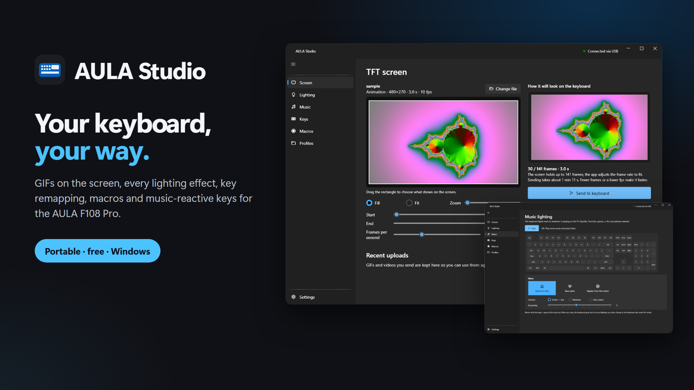

<div align="center">



**A simple, portable Windows app for the AULA F108 Pro keyboard.**<br>
Put GIFs and videos on its screen, control the lights, remap keys, record macros and make the keys react to music.

<a href="https://github.com/bacoinz/aula-studio/releases/latest"></a> <a href="LICENSE"></a>     <a href="https://ko-fi.com/bacoinz"></a>

[Download](https://github.com/bacoinz/aula-studio/releases/latest) · [Try it](#try-it) · [Troubleshooting](#troubleshooting) · [Other keyboards](#have-a-different-keyboard-ask-an-ai-to-adapt-it) · [Build from source](#build-from-source)

</div>

> [!NOTE]
> This is an unofficial project, not affiliated with AULA. It was built by studying how the keyboard's official app talks to the keyboard. Use it at your own risk.

## Why AULA Studio

The F108 Pro's official app works, but it is dated and hard to find your way around. AULA Studio does the same jobs in a clean Windows 11 style, and adds what the official app lacks: cropping and trimming GIFs, an image editor, profiles, automatic clock sync and music lighting.

- **Nothing to install:** unzip it and run it. You don't need .NET or FFmpeg, and your settings stay next to the exe.
- **Safe with the screen:** it never sends more than 141 frames, the screen's limit. Larger uploads can permanently corrupt the screen's menus.
- **Open source:** the code is here to read and change.

## Features

**Screen**

- **Drag in a GIF, video or image,** then crop, trim and preview it before sending it to the 240×135 screen.
- **The frame rate adjusts itself** to fit the 141-frame limit, and the app shows how long sending will take.
- **Compose an image** with your own text.
- **Recent uploads** are kept so you can send them again.

**Lighting**

- **All the keyboard's effects,** with colour, brightness, speed and direction.
- **Per-key colours:** paint keys one by one or use a preset.
- **Music lighting:** the keys react to whatever is playing on the PC. No microphone needed.
- **A guide to the FN shortcuts** for the side strips and light bar, which the keyboard doesn't let a PC control.

**Keys and macros**

- **Remap keys** on the normal and FN layers to other keys, shortcuts, mouse actions, media controls or macros.
- **Record macros** of keys and clicks, which the keyboard plays by itself.

**Everything else**

- **Profiles:** save a whole setup and switch between setups with one click.
- **Keyboard options:** sleep time, key response time, and locks for the Windows key, Alt+F4 and Alt+Tab.
- **Clock:** sets the screen clock from the PC whenever the keyboard connects.
- **2.4 GHz dongle:** everything except the screen works without the cable, and the app shows the battery level.

## Screenshots

<table>
  <tr>
    <td width="50%"></td>
    <td width="50%"></td>
  </tr>
  <tr>
    <td></td>
    <td></td>
  </tr>
  <tr>
    <td></td>
    <td></td>
  </tr>
</table>

## Try it

1. Close the official AULA app, because only one app can talk to the keyboard at a time.
2. Connect the keyboard with the **USB cable** or its **2.4 GHz dongle**.
3. Download the latest `AulaStudio-Portable` zip from the [releases page](https://github.com/bacoinz/aula-studio/releases/latest).
4. Unzip it to any folder you can write to (not `Program Files`) and open `AulaStudio.exe`.

To remove the app, delete the folder.

The app isn't digitally signed, so Windows may show a SmartScreen warning. To run it anyway, choose **More info**, then **Run anyway**.

**Updating:** to keep your settings, copy the `data` folder from the old version next to the new `AulaStudio.exe` before opening it.

## Compatibility

| | |
| --- | --- |
| Keyboard | **AULA F108 Pro only** (USB ID `0C45:800A`, dongle `05AC:024F`) |
| Connection | USB cable or 2.4 GHz dongle; Bluetooth isn't supported |
| System | Windows x64; tested on Windows 11 only |

Other AULA keyboards aren't detected.

Over 2.4 GHz everything works except the screen, which needs the cable, as in the official app. Music lighting works too, but the keyboard draws the effect itself, so the app's effect options don't apply.

## Troubleshooting

| Problem | What to do |
| --- | --- |
| The app says the keyboard isn't connected | Close the official AULA app, including from the tray, then unplug the keyboard and plug it back in. |
| F1–F12 work as media keys without FN | The keyboard is in Mac or another non-Windows mode. Choose **WIN** under **System** in the keyboard's screen menu. |
| Over 2.4 GHz, the Screen page is disabled | The screen only works over the cable. |

## Have a different keyboard? Ask an AI to adapt it

The app only works with the F108 Pro, but you can give this repository to an AI coding agent, such as [Claude Code](https://claude.com/claude-code) or [Codex](https://openai.com/codex/), and ask it to adapt the app to your keyboard. Other AULA models may use the same commands, or they may need new ones worked out, so the result isn't guaranteed.

Your keyboard doesn't have to be an AULA: you can also try adapting the code to another brand. Expect more work, because another brand is more likely to use different commands.

You'll need your keyboard and its official app, which the agent can study to see how your model differs. A prompt to start with:

```text
This repository is an app for the AULA F108 Pro keyboard. I want to adapt it to my
AULA [your model]. Its official app is installed at [folder].

Read docs/protocol.md first. Then compare my keyboard with the F108 Pro: USB IDs,
HID interfaces, commands, key and light layout, and screen size, if it has one.
Explain what differs before changing anything. Test with read-only commands first,
and ask me before sending anything that writes to the keyboard's memory.
```

These are the main places an agent will need to look:

| What | Where |
| --- | --- |
| The USB protocol, as worked out for the F108 Pro | [`docs/protocol.md`](docs/protocol.md) |
| USB IDs used to detect the keyboard | [`src/Aula.Protocol/WindowsHidTransport.cs`](src/Aula.Protocol/WindowsHidTransport.cs) |
| Commands and how they're sent | [`src/Aula.Protocol`](src/Aula.Protocol) |
| Key positions and light numbers | [`src/AulaStudio/Assets/f108pro-layout.json`](src/AulaStudio/Assets/f108pro-layout.json) |
| Screen format and frame limit | [`src/Aula.Protocol/LcdImage.cs`](src/Aula.Protocol/LcdImage.cs) |
| Command-line tool for testing commands | [`tools/aula-cli`](tools/aula-cli) |

> [!WARNING]
> **Be careful with writes.** Wrong commands could misconfigure a keyboard, especially the ones that write to its memory. On the F108 Pro, this app never sends more than 141 screen frames, which is the screen's limit; don't assume that limit applies to another model.

## How it works

| Part | What it uses |
| --- | --- |
| Interface | **WPF** on .NET 10, with [WPF-UI](https://github.com/lepoco/wpfui) for the Windows 11 look |
| Keyboard | Windows HID calls, with no driver to install |
| GIFs and videos | A small **FFmpeg** build, bundled in the portable zip |
| Music lighting | [NAudio](https://github.com/naudio/NAudio), listening to what the PC plays |

```
src/Aula.Protocol/   USB and 2.4 GHz commands: lighting, keys, macros, screen, clock
src/Aula.Media/      GIF and video conversion for the screen, through FFmpeg
src/AulaStudio/      The app (WPF)
tests/               Protocol and media tests
tools/aula-cli/      Command-line tool for testing commands
portable/            Scripts that build the small FFmpeg and the portable zip
docs/                USB protocol notes and screenshots
```

## Build from source

You need the [.NET 10 SDK](https://dotnet.microsoft.com/download/dotnet/10.0) on Windows.

```bash
dotnet build AulaStudio.sln
```

```bash
dotnet test AulaStudio.sln
```

```bash
dotnet run --project src/AulaStudio
```

GIF and video conversion needs FFmpeg on your `PATH`, or in an `ffmpeg` folder next to the exe. [`portable/README.md`](portable/README.md) explains how to build the small FFmpeg and the portable zip.

## Licence

AULA Studio is released under the [MIT Licence](LICENSE): you can use it, change it and share it, as long as you keep the copyright notice.

The portable build includes third-party software, including FFmpeg under the LGPL; see [`portable/THIRD-PARTY.txt`](portable/THIRD-PARTY.txt). "AULA" and "F108 Pro" are used only to name the keyboard this app works with.
